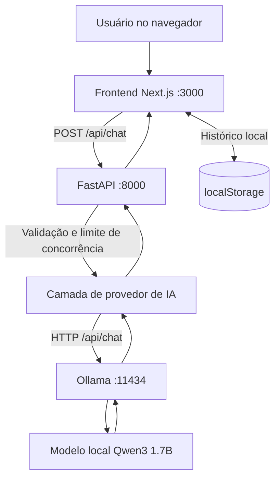
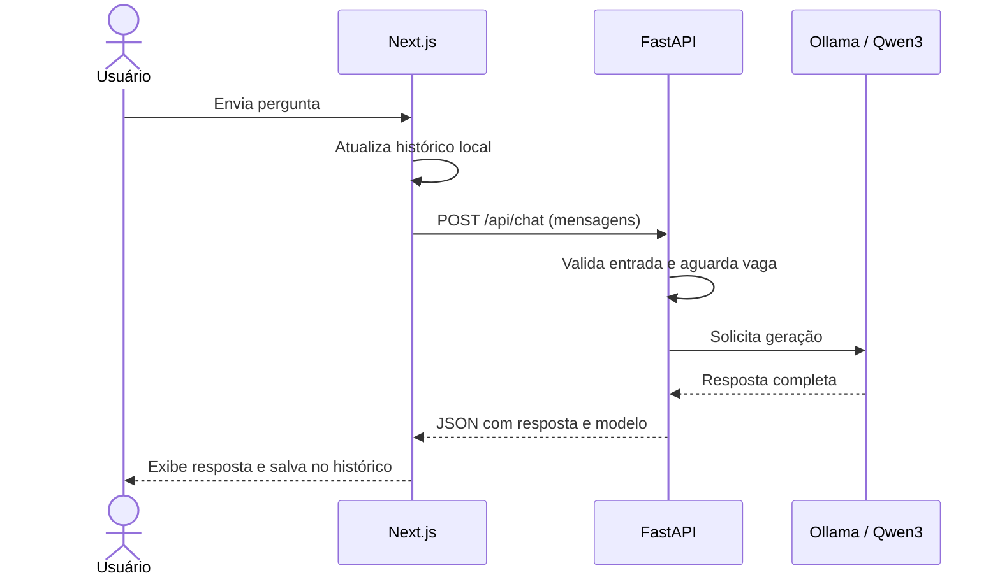
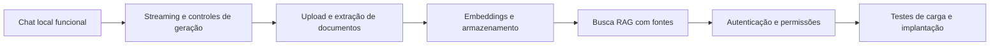
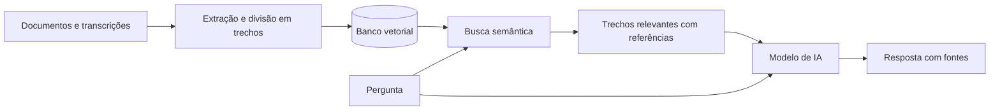

# Nexora AI

**Inteligência que conecta conhecimento.**

Assistente de IA local, construído com **Next.js**, **FastAPI** e **Ollama**. O objetivo é transformar documentos, treinamentos e procedimentos em respostas fundamentadas, por meio de uma futura base de conhecimento com RAG.


> **Estado atual:** chat com IA local funcional e testes básicos da API. **Ainda não** há upload de documentos, RAG, autenticação nem capacidade multiusuário validada.

## Visão geral

O Nexora AI é um projeto de assistente de conhecimento concebido para uso local e, futuramente, ambientes organizacionais **autorizados**. É desenvolvido de forma independente do modelo: a API conversa com um provedor configurável, enquanto a interface não precisa conhecer detalhes do Ollama.

### O que já funciona

- Interface de chat responsiva com **Next.js, TypeScript, Tailwind CSS, shadcn/ui e Lucide**.
- Criação, seleção, exclusão e histórico de conversas em **localStorage**.
- Envio de mensagens ao **FastAPI** e respostas reais de um modelo executado pelo **Ollama**.
- Indicador de geração de resposta, bloqueio temporário de novos envios e tratamento básico de erros.
- Limite inicial de inferências simultâneas **por processo** na API.
- Testes automatizados básicos com `unittest` e `httpx`.

## Arquitetura atual



### Fluxo de uma pergunta



> Atualmente as respostas são retornadas **ao final da geração**, sem streaming. O histórico fica no navegador e não é sincronizado entre usuários ou dispositivos.

## Tecnologias

| Camada | Tecnologia | Situação |
| --- | --- | --- |
| Frontend | Next.js 16, React 19, TypeScript, Tailwind CSS | Funcional |
| Componentes | shadcn/ui, Base UI, Lucide | Funcional |
| Backend | Python 3.12, FastAPI, Uvicorn, httpx | Funcional |
| Inferência | Ollama + Qwen3 1.7B | Funcional localmente |
| Testes | unittest + ASGITransport | 4 testes básicos |
| Banco de dados | PostgreSQL + pgvector | Planejado |
| Busca documental | Embeddings + RAG | Planejado |
| Implantação | Contêineres e infraestrutura | Planejado |

## Como executar localmente

### Pré-requisitos

- Node.js compatível com Next.js 16 e npm.
- Python 3.12.
- [Ollama](https://ollama.com/) instalado e em execução.
- Git.

### 1. Instalar o modelo

```powershell
ollama pull qwen3:1.7b
ollama list
```

### 2. Preparar o backend

Na raiz do projeto:

```powershell
py -3.12 -m venv backend/.venv
backend/.venv/Scripts/python.exe -m pip install -r backend/requirements.txt
Copy-Item backend/.env.example backend/.env
```

O arquivo `backend/.env` é local e ignorado pelo Git. Para usar outro modelo Ollama, ajuste `AI_MODEL` e faça o respectivo `ollama pull`. Ajuste `AI_BASE_URL` caso o serviço rode em outra máquina.

Inicie a API em **um terminal**:

```powershell
cd backend
./.venv/Scripts/python.exe -m uvicorn app.main:app --reload --host 127.0.0.1 --port 8000
```

Documentação interativa: [http://127.0.0.1:8000/docs](http://127.0.0.1:8000/docs).

### 3. Iniciar o frontend

Em **outro terminal**, a partir da raiz:

```powershell
cd frontend
npm install
npm run dev
```

Abra [http://localhost:3000](http://localhost:3000).

A URL padrão da API no frontend é `http://127.0.0.1:8000`. Para alterá-la, configure `NEXT_PUBLIC_API_URL` no ambiente do Next.js.

## Endpoints

| Método | Rota | Finalidade |
| --- | --- | --- |
| `GET` | `/health` | Confirma que a API está em execução; **não** valida o Ollama |
| `POST` | `/api/chat` | Envia até 30 mensagens e recebe uma resposta completa |

Exemplo do chat:

```json
{
  "messages": [
    { "role": "user", "content": "Explique o que é um ERP." }
  ]
}
```

## Executar testes

Na raiz do projeto:

```powershell
cd backend
./.venv/Scripts/python.exe -m unittest discover -s tests -v
```

No frontend:

```powershell
cd frontend
npm run typecheck
npm run lint
```

## Próximas entregas



### Como deverá funcionar a base de conhecimento (planejado)



O fluxo planejado deverá priorizar **transcrições de treinamento** para regras operacionais, complementar com **documentações de telas** e indicar quando não houver fonte suficiente. Essa recuperação documental ainda não está implementada.

## Limites e segurança

- O projeto é um **MVP de desenvolvimento**, não uma solução pronta para produção corporativa.
- O limite de inferências atual é **por processo**, não uma fila distribuída. O número de usuários simultâneos suportado ainda não foi medido.
- Não inclua documentos confidenciais ou dados corporativos sem autorização explícita e controles de acesso apropriados.
- Evite expor o Ollama ou o FastAPI diretamente na internet sem autenticação, isolamento e segurança adequados.
- A troca do **modelo de geração** é configurável no provedor Ollama; trocar de serviço de inferência pode exigir um novo adaptador. No futuro, trocar modelos de **embeddings** poderá exigir reindexar os documentos.

## Desenvolvimento

Projeto pessoal e independente, em evolução contínua. Alterações são organizadas em commits [Conventional Commits](https://www.conventionalcommits.org/), com entregas pequenas e verificáveis.

---

**Nexora AI — Inteligência que conecta conhecimento.**
